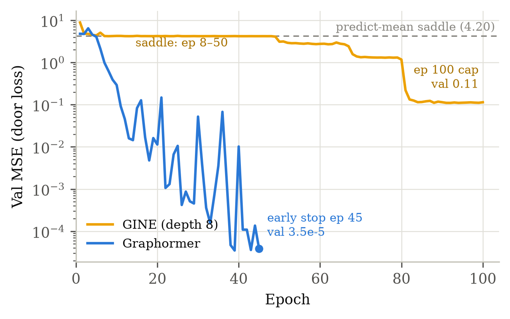
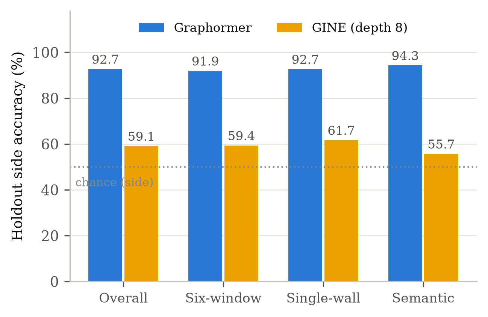

# 实验五：消息传递 baseline（GINE）——架构对照

**设定**：受控架构对照，在最终轮数据（run `2026JUL122211`，161 copies / 12 holdout）上
**只换图编码器**，其余全部与最终 Graphormer 配置一致：同一 HeterogeneousNodeEncoder
（TabTransformer + SDF latent）、同 scalar_s 头、同位姿蒸馏辅助头（w=0.3）、同
seed/split、同 100 epoch 预算与同早停规则（rolling val < 1e-3）。

- baseline = **GINE**（GIN with edge features，Hu et al. 2020），深度 8（感受野基本覆盖全图）、
  mean（度归一化）聚合，消息沿存储边双向传播。archive：`gin_scalar_s_pose_w0.3`。
- 此前两次 GINE 尝试（sum 聚合 depth 4；mean depth 8 只跑 12 ep）均未脱离
  predict-mean 鞍点（Val ≈ 4.2），日志存
  `intermediate/gin_baseline_attempt{1,2}_*.log`（数据也在 `data/gin_baseline.json` 的 curves 里）。

**结果**（同 run 的 Graphormer archive `scalar_s_pose_w0.3` 作对照）：

| | Graphormer | GINE (depth 8) |
|---|---|---|
| best Val MSE / 收敛 | **3.5e-5**，早停 45/100 ep | 0.110，跑满 100 ep 仍未达早停阈值 |
| 鞍点逃逸 | ~ep 8 | ~ep 50（此后阶梯式缓慢下降） |
| seen test 侧别 / 中位误差 | 100% / 3.3 mm | 91.8% / 36.6 mm |
| holdout 侧别 / exact-slot | **92.7% / 89.2%** | 59.1% / 44.4% |
| holdout 中位误差 / >0.5 m 占比 | 6.2 mm / 10.8% | 510 mm / 51.8% |
| holdout 按规则（六窗/单侧墙/语义）| 91.9 / 92.7 / 94.3% | 59.4 / 61.7 / 55.7% |
| per-copy 侧别范围 | 80.8–100% | 33.1–83.2%（3 个 copy 低于随机 = 整 copy 镜像）|

**结论**：

1. **优势在优化与归纳偏置，不在感受野**：depth 8 的 GINE 感受野已覆盖全图，仍在
   predict-mean 鞍点上滞留约 50 epoch（Graphormer 同数据 ~8 epoch 破位），到 100 epoch
   上限时 Val 仍比 Graphormer 高 3 个数量级、连 seen test 都未解干净（91.8%）。
   实验二证明的"线性可读出"上限对两个架构同样存在——差距是学习动力学造成的。
2. **holdout 上 GINE 接近随机**（59.1%，三条规则全在 55–62%），且 per-copy 分布
   出现低于随机的整 copy 镜像——与 Graphormer 早期（无蒸馏、少 copies）的失败模式
   同形，但 GINE 在位姿蒸馏与 161 copies 都在场的条件下仍停在这里。
3. 对论文的意义：门放置任务的三条规则都需要**远距离多跳关系**（马桶在哪侧、
   TYPE2 窗在哪个槽位、墙长是否过阈值），稠密注意力 + 结构编码让这些关系一跳可达；
   逐边消息传递即使深度足够也难以在同预算内优化到位。

**公平性说明**：GINE 每 epoch 便宜得多（~1.5 min vs Graphormer ~8.5 min），按 wallclock
计 GINE 只用了 ~2.7 h vs ~6.5 h；但按相同 epoch 预算与相同早停规则，GINE 是在
loss 仍缓慢下降时到达 100 ep 上限的——不排除更长训练最终收敛，本文声称的是
"同预算下未达"，而非"不可达"。

**文件**：
- `extract_data.py` → `data/gin_baseline.json`（seen/holdout 全局与按规则指标、per-copy、
  从日志解析的 val 曲线，含两次失败尝试）
- `make_figures.py` → `figures/fig_gin_curve.{png,pdf}`、`figures/fig_gin_rules.{png,pdf}`
