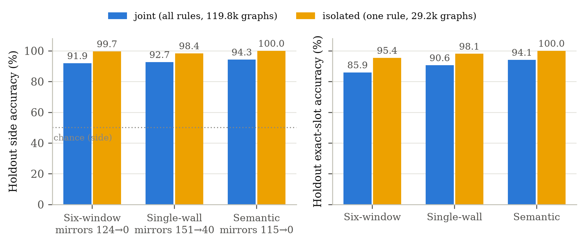
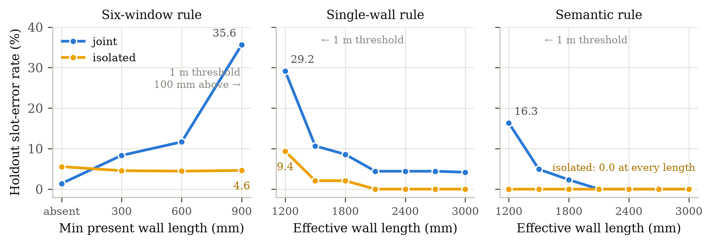

# 实验七：单规则消融——规则隔离的因果检验

**设定**：把第八轮（run `2026JUL122211`，161 copies / 12 holdout 变换）的训练池按
放置规则切成三份（经文件名判定，与 `determine_door_position` 一致），**均衡到最小
规则的规模**（每份 29,204 张图 = 联合模型 119,796 张的 24%），然后各自用与最终模型
**完全相同的配置**（scalar_s 头、位姿蒸馏 w=0.3、同 seed/split/早停规则）重训一个
单规则模型。holdout 仍是同 12 个未见变换，按规则限定（六窗 4608 / 单侧墙 2688 /
语义 2352），与联合模型的按规则子集**逐图相同**——两种条件在完全一致的评估集上对比。

关键的因果设计点：均衡目标恰好是语义规则的总图数，因此**语义单规则模型的训练集
与联合模型见过的语义子集一字不差**——两者唯一的差别是联合模型额外看了 9 万张
其他规则的图。语义规则上的任何差距都只能归因于"多规则混合"本身。

**结果**（holdout，joint = 联合模型按规则子集，isolated = 单规则模型）：

| 规则 | 侧别 joint→isolated | exact-slot | 精确镜像数 | >0.5 m 占比 |
|---|---|---|---|---|
| 六窗 (n=4608) | 91.9 → **99.7%** | 85.9 → **95.4%** | 124 → **0** | 14.1 → 4.2% |
| 单侧墙 (n=2688) | 92.7 → **98.4%** | 90.6 → **98.1%** | 151 → 40 | 9.4 → 1.9% |
| 语义 (n=2352) | 94.3 → **100%** | 94.1 → **100%** | 115 → **0** | 5.9 → **0%** |

**结论**：

1. **每条规则在隔离条件下都以约 1/4 的数据学到近乎完美并迁移到未见变换**
   （98.4–100% 侧别），语义规则——曾经的"纯随机手性"——12 个 holdout copy 全部
   100%/100%，零镜像。单条规则的几何能力不是瓶颈；**联合模型 92.7% 的缺口来自
   规则复合本身**。
2. **实验六的阈值假设得到因果验证**：联合模型的槽位错误率沿"决定性墙长离 1 m
   阈值的距离"单调爬升（六窗 900 mm 处 35.6%、单侧墙 1200 mm 处 29.2%、语义
   1200 mm 处 16.3%），规则一旦固定，这个梯度在不再需要阈值判别的两条规则上
   **完全消失**（六窗压平到 ~4.6%，语义全程 0%），只在单侧墙规则残留一个缩小的
   近阈值峰（1200 mm 处 9.4%→2100 mm 起 0%）——因为"哪面墙有效"这个判断
   在规则内部仍然需要读长度过阈值：其 44 个失败里 40 个是精确镜像，墙长组合
   集中在 (900,1200)、(600,1200)、(900,1500) 等阈值 ±200 mm 内，机制正是认错
   有效墙。失败的空间分布与阈值机制的预测逐点吻合。
3. **手性泛化在 161 copies + 位姿蒸馏下已被完全解决**（语义隔离 100%），无需再
   报告为负结果；剩余问题被干净地隔离为"用于规则选择的墙长读出精度"，直接
   指向与位姿蒸馏同构的长度/尺度蒸馏辅助头（本文范围之外的下一步）。
4. 附带观察：六窗隔离模型的中位误差 38.1 mm 反而比联合模型（10.5 mm）粗
   （训练图 29.2k vs 联合模型见过的 57.2k 张六窗图；best Val 2.9e-4 vs 3.5e-5）——
   数据量买到的是**精细位置精度**，混合训练损失的是**规则判别**，两者是不同的轴。

**细节备注**：
- 六窗隔离模型 16 个"侧别错"全部来自单一 copy aug157 的 W3 槽位（s=−0.475）被
  预测为 ≈0 的近中心涂抹，并非镜像——中间槽位上 sign 指标偏苛刻。
- 单规则模型 seen test 均正常收敛（中位 6.7–11.5 mm，侧别 100%）。
- per-copy 侧别：六窗 95.8–100%、单侧墙 94.6–100%、语义 12 个 copy 全 100%。

**文件**：
- `extract_data.py` → `data/single_rule.json`（joint/isolated 按规则指标、阈值曲线、
  per-copy、训练规模与 seen test）
- `make_figures.py` → `figures/fig_rule_isolation.{png,pdf}`、
  `figures/fig_isolation_threshold.{png,pdf}`
- 原始 archive：`data/runs/2026JUL122211/output/experiments/ablation_{six_window,single_wall,semantic}/`
  （各含评估报告、`ablation_manifest.json` 文件清单与 checkpoint）
